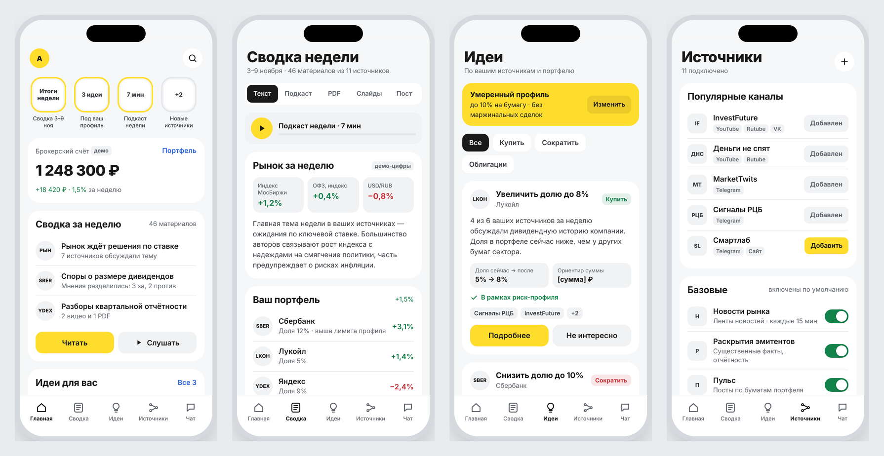
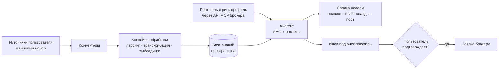
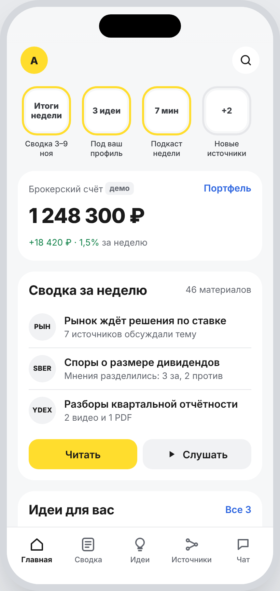
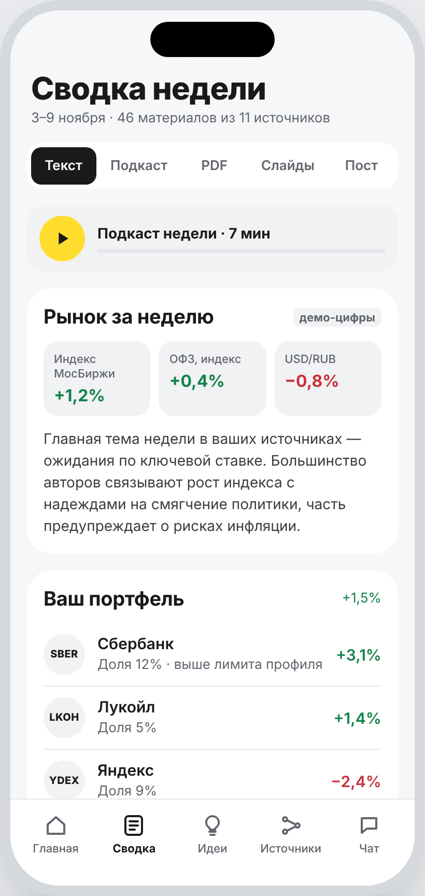
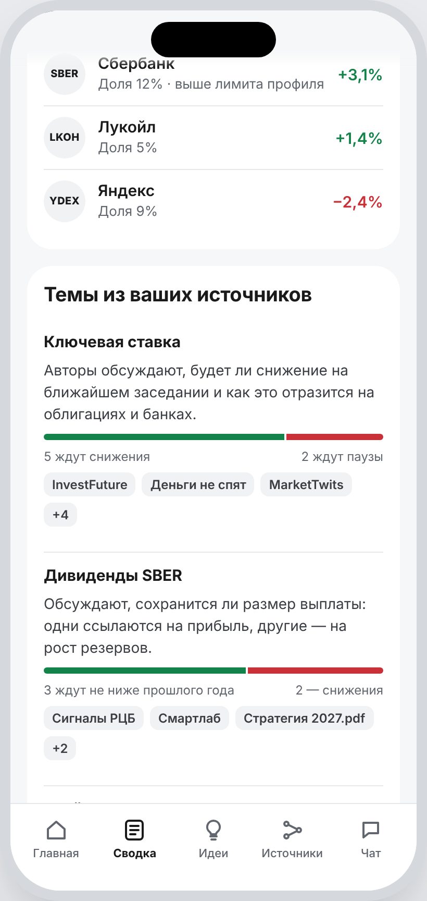
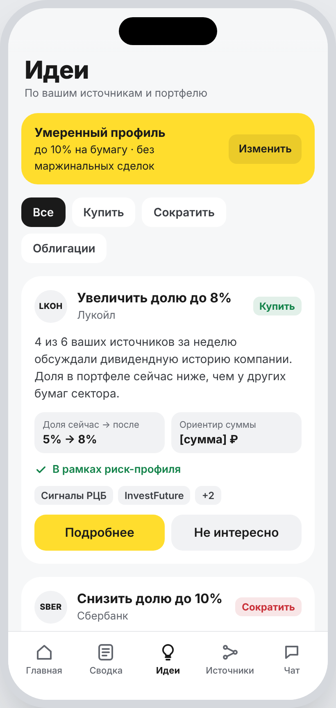
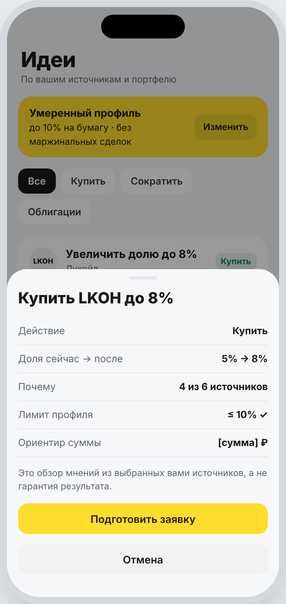
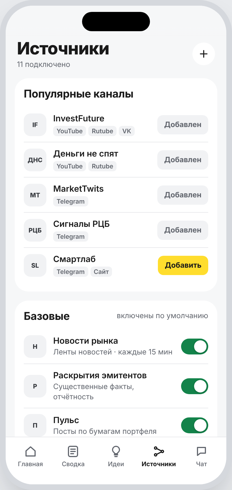
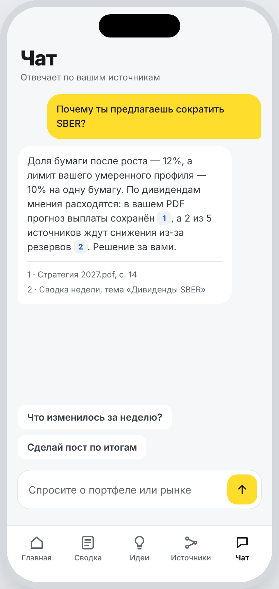
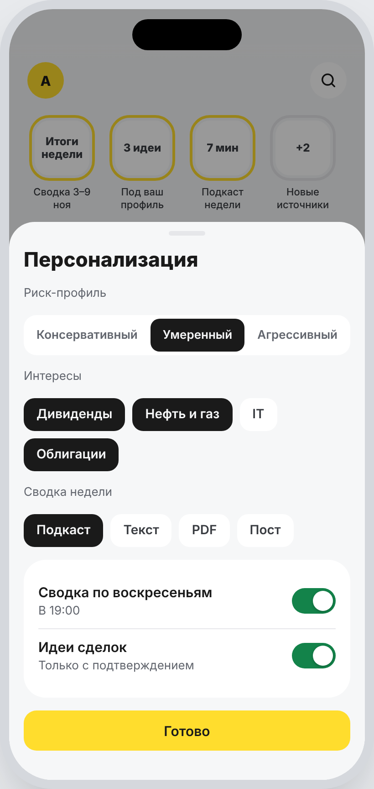

# Инвест-ноутбук

AI-ассистент инвестора по модели NotebookLM. Это рабочее пространство внутри брокерского приложения, где инвестор подключает источники, которым доверяет. Ассистент превращает их в недельную сводку в удобном формате и предлагает идеи под риск-профиль.

> Концепт для AI-челленджа «Инвест.Премаркет». Не является продуктом или разработкой какой-либо компании.

**Демо-макет:** https://<логин>.github.io/invest-notebook/

---

## Проблема

Активные инвесторы следят за десятками каналов, подкастов, видео и отчётов. Важное теряется в ленте, на разбор уходят часы, а связывать прочитанное со своим портфелем приходится вручную. В инвесткомпаниях этим вручную заняты целые команды аналитиков.

## Решение

Пространство с **коннекторами** к источникам и **инструментами** для их обработки.

- **Источники выбирает пользователь.** Есть базовый набор (новости рынка, раскрытия эмитентов, Пульс), к нему добавляются популярные каналы и свои материалы: YouTube, Rutube, VK, Telegram, Max, PDF, аудио и видео.
- **Ассистент собирает и актуализирует материалы.** Он расшифровывает аудио и видео, извлекает тезисы и прогнозы, привязывает их к бумагам портфеля, следит за рынком в целом и проводит фундаментальный анализ по отчётности.
- **Сводка недели в удобном формате:** текст, подкаст, PDF, презентация или пост, всегда со ссылками на источники.
- **Идеи сделок под риск-профиль.** У каждой идеи есть объяснение и источники. Заявка отправляется только после подтверждения пользователем.
- **Чат.** Можно задавать вопросы по портфелю и рынку и получать ответы по выбранным источникам.
- **Персонализация.** Ассистент учитывает портфель, риск-профиль, интересы, любимый формат и расписание сводок.

## Основной сценарий

1. Коннекторы по расписанию забирают новые материалы из подключённых источников.
2. Конвейер расшифровывает аудио и видео, режет материалы на фрагменты и индексирует их.
3. Раз в неделю или по запросу агент находит релевантное через RAG и берёт портфель и риск-профиль через MCP. Метрики он считает в модуле расчётов, а затем пишет анализ.
4. Инструмент генерации собирает сводку в выбранном формате, со ссылками на источники.
5. Пользователь читает или слушает сводку, уточняет детали в чате и выбирает идею. Ассистент готовит заявку, а исполняется она только после подтверждения.

## Что делает AI, а что нет

| AI | Обычный код и правила |
|---|---|
| Расшифровка аудио и видео | Сбор данных коннекторами |
| Извлечение тезисов и прогнозов, привязка к бумагам | Расчёт портфеля и мультипликаторов |
| Сведение мнений разных авторов | Проверка лимитов риск-профиля |
| Наблюдение за рынком, интерпретация отчётности | Исполнение заявок |
| Генерация сводок, подкастов, презентаций, постов | |
| Диалог и подбор идей | |

Без AI здесь не обойтись. Источники неструктурированы: в них сленг, ирония, «зелёный банк» вместо SBER. Поиск находит упоминание, но не понимает позицию автора, а шаблоны не сожмут сотни материалов в персональную сводку. Где нужны точность и правила, AI не используется.

## AI-подходы

- **LLM** для понимания текстов, анализа, сводок и диалога.
- **RAG**, чтобы ответы строились только по выбранным источникам и со ссылками.
- **AI-агент** сам собирает данные, вызывает инструменты (PDF, подкасты) и работает со счётом через MCP.
- **Обработка речи:** расшифровка подкастов и видео, озвучка сводок.
- **Рекомендательная система** подбирает идеи под портфель и риск-профиль.

## Архитектура MVP

| Слой | Компоненты |
|---|---|
| Клиент | Раздел в инвест-приложении: главная, сводка, идеи, источники, чат |
| Бэкенд | AI-агент-оркестратор, сервис коннекторов, конвейер обработки, RAG-поиск, модуль расчётов, инструменты генерации, планировщик |
| Модели | LLM в контуре банка, эмбеддинги (bge-m3), Whisper для речи, TTS для подкастов |
| Хранилища | PostgreSQL (пользователи, профили, источники), Qdrant (векторы), S3 (файлы, аудио, сводки), Redis (очереди) |
| Внешние API | API/MCP брокера (портфель, котировки, заявки), MOEX ISS, ленты новостей, площадки источников |

## Данные

| Тип | Источники | Формат | Обновление |
|---|---|---|---|
| Тексты | Новости, каналы, Пульс | Текст, JSON | Каждые 15–60 мин |
| Аудио и видео | Подкасты, видеоканалы | mp3/mp4 → транскрипт | При выходе нового |
| Документы | Отчётность, презентации, отчёты аналитиков | PDF | Раз в квартал и при загрузке |
| Рыночные | Котировки, объёмы, дивиденды | JSON | Ежедневно и по запросу |
| Пользовательские | Портфель, сделки, риск-профиль | API/MCP | При каждом запросе |

## Как проверим, что решение работает

- **Гипотеза:** с ассистентом инвесторы чаще совершают сделки.
- **Эксперимент:** A/B-тест на 4 недели, 200–500 клиентов, контрольная группа без ассистента.
- **Основная метрика:** число сделок на пользователя в неделю (любых, не только по идеям ассистента).
- **Дополнительная метрика:** доля целевых сделок, то есть совпадающих с идеей ассистента по бумаге и направлению в течение 3 дней.
- **Успех:** рост сделок на 15% и больше к контрольной группе, со статистической значимостью.

Доходность сделок мы не оцениваем, потому что источники выбирает пользователь. Мы отвечаем за две вещи:
- **точность:** не меньше 95% утверждений верно передают источник;
- **соответствие профилю:** 100% идей укладываются в риск-профиль клиента (эту проверку делает код по правилам).

## Риски

1. **Порог входа.** Пользователь может не захотеть настраивать источники. Снижаем этот риск базовым набором и онбордингом.
2. **Доступ к данным.** Ограничения API площадок, блокировки, авторские права.
3. **Качество AI.** Галлюцинации и ошибки распознавания жаргона. Цель — точность не ниже 95% на размеченной выборке.
4. **Спрос.** Сводки могут не стать привычкой.
5. **Репутация.** Клиент может потерять деньги на идее и обвинить банк. Подачу идей согласуем с комплаенсом.

## Макет

`index.html` — интерактивный макет приложения в одном файле, без сборки и зависимостей. Его можно открыть локально в браузере или опубликовать через GitHub Pages: **Settings → Pages → Deploy from a branch → main / root**.

### Скриншоты

| Главная | Сводка недели | Темы из источников |
|:---:|:---:|:---:|
|  |  |  |
| Истории, счёт, превью сводки и идей | Формат на выбор, подкаст, рынок и портфель | Мнения авторов и источники по каждой теме |

| Идеи | Подтверждение идеи | Источники |
|:---:|:---:|:---:|
|  |  |  |
| Идеи под риск-профиль с объяснением | Заявка — только после подтверждения | Популярные каналы, базовые и свои источники |

| Чат | Персонализация |
|:---:|:---:|
|  |  |
| Ответы со ссылками на источники | Риск-профиль, интересы, формат и расписание |

---

*Названия каналов в макете приведены как примеры подключаемых источников. Содержание выпусков, цифры и идеи условные и не являются инвестиционной рекомендацией.*
